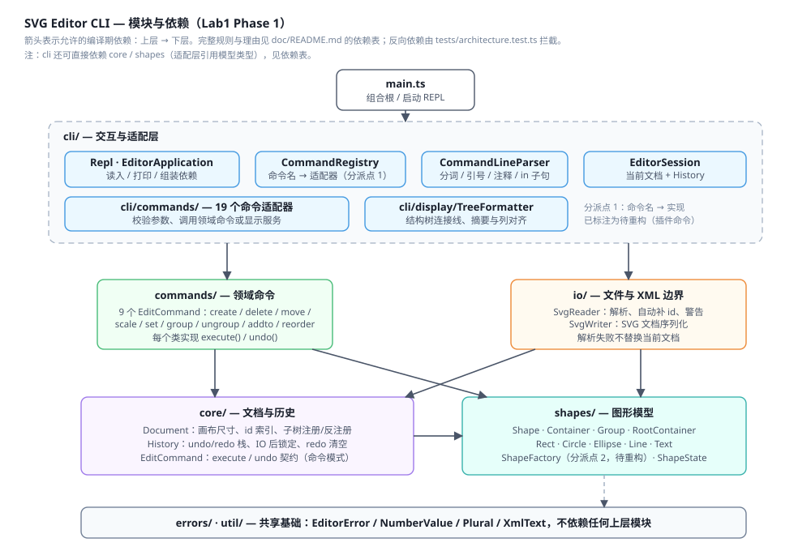
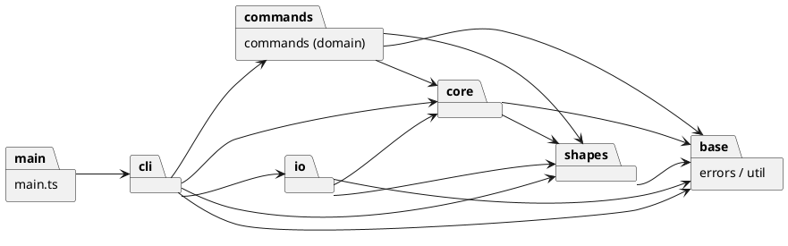

# Lab1 Phase 1 — SVG 编辑器（CLI）

实现语言为 TypeScript，运行在 Node.js 上。命令行通过 `npm run cli` 启动，所有编辑命令共享一套 undo/redo 历史；SVG 读写、自动补 id、复合图形、错误原子性等行为按实验说明实现。

- Git 仓库：<https://github.com/Stajaaj/svg-editor-cli>
- 运行：`npm install`，然后 `npm run cli`
- 测试：`npm test`（40 个测试，8 个测试文件）
- 类型检查：`npm run typecheck`
- 文档：本文件；架构图为 [architecture.svg](architecture.svg)

---

## 架构方案

### 1. 模块划分

| 目录 / 文件 | 职责 | 关键类型 | 允许依赖 |
|---|---|---|---|
| `src/cli/` |  REPL、分词、命令注册、会话、参数校验、显示格式化、CLI 适配器 | `Repl`、`EditorApplication`、`CommandRegistry`、`CommandLineParser`、`EditorSession`、`*CliCommand`、`TreeFormatter` | `commands`、`io`、`core`、`shapes`、`errors`、`util` |
| `src/commands/` | 9 个可撤销的领域编辑命令，只关心“做什么/怎么撤销” | `CreateShapeCommand`、`DeleteShapeCommand`、`MoveShapesCommand`、`ScaleShapesCommand`、`SetAttributeCommand`、`GroupShapesCommand`、`UngroupCommand`、`AddToContainerCommand`、`ReorderCommand` | `core`、`shapes`、`errors`、`util` |
| `src/core/` | 文档状态、id 索引、子树注册/反注册、撤销/重做历史与 IO 锁定 | `Document`、`History`、`EditCommand` | `shapes`、`errors`、`util` |
| `src/io/` | 文件与 XML 边界：SVG 解析、序列化、缺省 id 补全、读写错误处理 | `SvgReader`、`SvgWriter`、`ReadResult` | `core`、`shapes`、`errors`、`util` |
| `src/shapes/` | Composite 图形模型：几何变换、属性、状态快照、自身 SVG 片段与显示描述、类型工厂 | `Shape`、`Container`、`Group`、`RootContainer`、`Rect`、`Circle`、`Ellipse`、`Line`、`Text`、`ShapeFactory`、`ShapeState` | `errors`、`util` |
| `src/errors/`、`src/util/` | 公共错误类型、数字格式/解析、英文单复数、XML 转义 | `EditorError`、`NumberValue`、`Plural`、`XmlText` | `errors`（仅 `util`） |
| `src/main.ts` | 组合根：创建 `EditorApplication` 与 `Repl` | — | `cli` |
| `tests/` | 单元、集成、CLI transcript、架构依赖测试 | Vitest 测试 | 允许测试所有模块 |

`cli/` 与 `commands/` 是两层命令：`cli/commands/` 负责语法解析、参数校验、把 id 解析为对象；`commands/` 才是可撤销的领域对象。这样 REPL 语法变化不会污染撤销逻辑，领域命令也不依赖任何输入输出形式。

实际目录（节选）：

```text
src/
├── main.ts
├── cli/
│   ├── EditorApplication.ts  EditorSession.ts  Repl.ts
│   ├── CommandLineParser.ts  CommandRegistry.ts
│   ├── commands/             (19 个 CLI 适配器)
│   └── display/TreeFormatter.ts
├── commands/                 (9 个领域 EditCommand)
├── core/                     Document.ts  History.ts  EditCommand.ts
├── io/                       SvgReader.ts  SvgWriter.ts
├── shapes/                   Shape/Container/Group/...  ShapeFactory.ts
├── errors/EditorError.ts
└── util/                     NumberValue.ts  Plural.ts  XmlText.ts
```



对应的 PlantUML 包图（与上图一致，箭头表示允许的编译期依赖）：



### 2. 设计模式的选择

#### 2.1 Command（实验要求，核心模式）

- 契约：[`EditCommand`](../src/core/EditCommand.ts) 只有 `execute()` 与 `undo()`，二者都返回给用户看的结果摘要。
- 具体命令：[`src/commands/`](../src/commands/) 下 9 个类，每个类封装一次完整编辑：
  - 属性编辑：`MoveShapesCommand`、`ScaleShapesCommand`、`SetAttributeCommand`；
  - 结构编辑：`CreateShapeCommand`、`DeleteShapeCommand`、`GroupShapesCommand`、`UngroupCommand`、`AddToContainerCommand`、`ReorderCommand`。
- 调用者/Invoker：[`History`](../src/core/History.ts)。它负责压栈、清空 redo、执行/撤销、IO 后的锁定。
- 客户端：[`cli/commands/`](../src/cli/commands/) 中的适配器负责把一行文本变成参数校验后的领域命令，再交给 `History.execute`。
- 撤销单元：一行输入对应一个 `execute`；`group g1 r1 r2` 是一个整体，undo 一次恢复全部子节点、原父容器和原 z-order。`delete` 保存被删子树与插入位置。
- 优点：新增编辑行为只需新增一个命令类；REPL、撤销栈、消息格式不需要修改。显示类命令不进入 `History`，文档类命令通过 `History.markIoCommand()` / `reset()` 管理锁定与清空。

#### 2.2 Composite（容器与叶子统一处理）

- [`Shape`](../src/shapes/Shape.ts) 是抽象组件；[`Container`](../src/shapes/Container.ts) 增加子节点管理；[`Group`](../src/shapes/Group.ts) 是可寻址的容器；[`RootContainer`](../src/shapes/RootContainer.ts) 是画布根（不对应可编辑 id）。
- `translate` / `scale` / `captureState` 在容器中递归到子节点；`move`、`scale`、`set`、`delete`、`front`、`back`、`tree` 等命令对 `g` 与叶子一视同仁。
- `TreeFormatter` 只依赖 `Container.children` 做递归遍历，不按标签类型分派。
- 后续插件 `box` 可以直接作为 `Group` 的扩展实现复合语义。

#### 2.3 Factory + Registry（两个“按名字分派”的允许点）

实验明确只允许两处按名字分派，本实现中为：

1. [`CommandRegistry`](../src/cli/CommandRegistry.ts)：命令名 → `CliCommand` 实现。`EditorApplication` 在组合根注册 19 个命令；`help` 的用法/描述也来自同一份注册元数据。
2. [`ShapeFactory`](../src/shapes/ShapeFactory.ts)：图形类型名 → 具体 `Shape` 类，同时集中维护每种类型的参数个数、是否容器等元数据。`Read` 和 `Create` 都通过它获得类型知识，其他模块不再按标签名分派。

两处都已在代码注释中标注为待重构，目标是插件化阶段替换为动态注册表 / `ShapeProvider` 注册表，而不是在多个模块里增加 `switch(tag)`。本阶段没有第三处按标签名分派。

#### 2.4 Memento（精确撤销）

[`ShapeState`](../src/shapes/ShapeState.ts) 是一个恢复闭包；每个 `Shape` / `Container` 的 `captureState()` 捕获自身（以及子节点）的几何、视觉属性与文本内容。`MoveShapesCommand` / `ScaleShapesCommand` / `SetAttributeCommand` 在执行前捕获快照，undo 时恢复原状态。

没有采用“反向操作”（移动取反、缩放取 `1/factor`）的原因：

- 缩放 `0.1` 之类因子再取倒数会有浮点误差，undo 后未必回到原始值；
- 容器递归缩放、复合图形、文本内容等多属性场景下，反向操作容易漏字段；
- 快照对属性和结构命令都适用，且实现简单、可测试。结构命令（delete/group/ungroup/addto）则额外保存原父容器、原索引、子树引用，不复制子树。

#### 2.5 其他设计

- 容器/叶子的 SVG 片段与树摘要由图形自身以多态方式提供（`toSvg`、`treeSummary`、`geometryAttributes`），避免在 `io` 或显示层写类型 `switch`。这是有意作出的职责取舍：模型知道自己的一行描述与 SVG 片段，`io` 只负责文件与 XML 编排。
- 未为了“多一个模式”引入 Visitor、Strategy 等；当前变化点集中在图形类型、插件和导出格式，已在变化点中说明。

### 3. 依赖方向规则

| 模块 | 可以依赖 | 不能依赖 | 理由 |
|---|---|---|---|
| `shapes` | `errors`、`util` | 其余全部 | 领域图形模型是底层；不应知道文档、命令、IO、REPL |
| `core` | `shapes`、`errors`、`util` | `commands`、`io`、`cli` | 文档/历史管理模型对象；不负责编辑语义、不负责文件、不负责交互 |
| `commands` | `core`、`shapes`、`errors`、`util` | `io`、`cli` | 领域命令只操作文档与图形；输入解析、渲染输出由上层负责 |
| `io` | `core`、`shapes`、`errors`、`util` | `commands`、`cli` | 读写需要构造文档/图形，但不需要依赖编辑命令或 REPL |
| `cli` | `commands`、`io`、`core`、`shapes`、`errors`、`util` | 无（仅允许向下） | 作为最上层适配层，负责解析、分发、显示以及调用全部下层能力 |
| `main.ts` | `cli` | 其余全部 | 组合根只负责装配与启动 |
| `errors` / `util` | 仅 `util → errors` | 其余全部 | 公共基础，不依赖任何上层 |

规则总结：依赖箭头只能从 `main → cli → commands/io → core → shapes → errors/util` 方向流动。`commands` 与 `io` 是并列的，不允许互相依赖；`shapes` 是叶子模块。

执行方式：

- [`tests/architecture.test.ts`](../tests/architecture.test.ts) 扫描 `src/**/*.ts` 的 `import ... from` / `export ... from`，解析相对路径后的模块并断言只命中上表允许的边；同时检查“一类一文件（文件名 = 类名）”。
- 运行：`npx vitest run tests/architecture.test.ts`。
- 当前结果：无违规；待处理依赖项为 0。若未来出现反向依赖，测试会失败并列出具体文件和目标模块。

需要说明的是，`shapes` 自己负责生成 SVG 片段和树摘要，而不是把这两件事放到 `io` / `cli`。这不会产生模块间的“向上依赖”，但确实是职责边界上的一个取舍，已记录在变化点第 5 条。

### 4. 变化点假设

以下是我认为未来最可能变化的地方，以及本轮为它们留的口子或明确不做决定的理由：

| # | 变化点 | 本轮预留 / 决定 | 理由 |
|---|---|---|---|
| 1 | **新增图形类型（最先到来：`box` 插件）** | 所有类型名、参数个数、是否容器等元数据集中在 [`ShapeFactory`](../src/shapes/ShapeFactory.ts)；`CreateCliCommand`、`SvgReader`、`SvgWriter` 均不按标签分支；`Group.canUngroup` 已为“插件拥有内部结构的复合图形”留了拒绝钩子 | 实验明确后续是插件化阶段。插件化时把工厂替换为 `ShapeProvider` 注册表，内核无需修改；本阶段不提前实现 `box` |
| 2 | **复合图形的专属语义**（`box` 的 fill/label 传播、`data-kind` 读回、禁止 ungroup） | `Container` 可被继承；`Group` 的 `canUngroup` 与 `UngroupCliCommand` 的 composite 错误路径已存在；树显示与序列化按多态扩展 | 本阶段 `box` 不在范围内，提前做会把插件接口定死；`g` 的通用 Composite 语义已完整 |
| 3 | **组级 transform / 矩阵** | 按实验要求采用“递归修改每个子孙的几何属性”，不维护 `transform`；读取外部 SVG 时忽略 transform 属性 | 如果支持矩阵，move/scale/序列化/撤销都要做矩阵复合；当前规格只定义递归缩放，引入变换模型是额外复杂度。若未来需要，增加 `Transform` 值对象并修改接口 |
| 4 | **撤销粒度与事务（宏命令、命令合并）** | `EditCommand` 接口与 `History` 已经支持任意命令对象；可以新增 `MacroCommand` 或合并策略 | 本阶段规定“一行 = 一个 undo 单元”，没有 UI 连续拖动/输入合并需求；不提前造命令框架 |
| 5 | **SVG 解析保真度（未知属性、样式、`font-size`、`text-anchor`、`defs`、transform）** | 读取只建模命令行可设置的白名单属性；未知属性忽略，未知元素跳过并告警（`title/desc/metadata/defs/style` 静默跳过）；写出只写建模属性 | 命令白名单是封闭的；属性透传会牵扯 set/undo/serialization 的一致性。若要求高保真，可在 `io` 增加属性透传或 Visitor 导出器 |
| 6 | **CLI 命令与语法扩展（别名、批量、插件命令）** | `CommandRegistry` 保存 name / usage / description / category；新增命令只需在组合根注册；`help` 自动汇总 | 这是命令行入口最自然的变化点；但本阶段仍按实验只做 19 个内置命令，不做插件命令 |
| 7 | **多文档 / 多画布 / 窗口** | `EditorSession` 持有当前 `Document` 与 `History`；`Document` 不依赖 CLI | 当前规格只有一个当前文档；多文档需要会话管理层，提前做会引出未定义的生命周期问题 |
| 8 | **id 之外的寻址方式（路径地址）** | `Document` 集中维护 id → shape 索引；所有命令只按 id 访问 | 实验明确本阶段不要求路径寻址；若需要，应在 `Document` 增加地址解析器并只修改 CLI 参数解析 |

---

## 过程记录

以下记录本轮与 AI 协作中比较有代表性的讨论、发现与纠正。每条都给出了验证方式。

### 1. 从“上帝类 + switch(tag)”收敛到分层 + 两个分派点

AI 的初版方案倾向于把“解析、执行、序列化、树显示、撤销”都放进一个 `Editor` 类，并按图形标签 `switch` 处理。对照实验 2.1 后确认这违反两项要求：

- 贫血/过程式分派会随着类型增加不断膨胀，难以定位修改点；
- 类层次、封装和 IO 边界都不清楚。

处理方式：拆出 `shapes`（多态图形模型）、`core`（文档/历史）、`commands`（领域命令）、`io`（SVG 边界）、`cli`（解析/显示/REPL）；只保留 `CommandRegistry` 与 `ShapeFactory` 两个允许的名字分派点，并在代码和本文档中标注为待重构。随后新增 [`tests/architecture.test.ts`](../tests/architecture.test.ts) 自动检查依赖方向与一类一文件，防止后续迭代又退回“到处 switch”。

### 2. 撤销从“反向操作”改为 Memento 快照

最初的直觉是 move 撤销 `dx/dy` 取反、scale 撤销 `1/factor`。讨论中发现两个问题：

- 浮点误差：`0.1` 缩放的逆操作未必精确回到原值，undo 后 `show` 会出现 `10.000000000000002` 一类结果；
- 容器递归缩放和文本内容/视觉属性涉及多个字段，反向操作容易漏掉属性。

最终采用 `ShapeState` 快照（Memento）：命令执行前捕获受影响子树，undo 精确恢复。结构命令另存父容器与索引。验证用例覆盖了带小数的 move、容器 scale、set 后 undo，以及 group/delete 的结构恢复。

### 3. IO 后 undo/redo 的锁定语义

一开始对实验 4.3 的理解是“IO 后清空历史”。仔细核对“执行后 undo/redo 禁止，直到下一次编辑命令重新解禁”后，改为：

- `init` / `read`：用 `History.reset()` 重置栈并锁定；
- `save` / `canvas` 修改尺寸：`markIoCommand()` 只锁定，不清空栈；
- 下一次**成功**的编辑命令解锁（失败的编辑不改变状态，因此不解锁）；
- 被禁止时统一返回 `error: undo not allowed after io command`。

这些分支都有测试（`tests/cli-errors.test.ts`），包括“save → 编辑 → undo”和“save 失败不锁定”。

### 4. `in` 子句与带引号的 “in” 文本

分词器最初只保存 token 字符串，`create` 直接查找字面量 `in`，导致 `create text t 1 2 "in"` 被误判为在寻找容器。核实后改为：

- `Token` 记录 `quoted` 标志；
- `create` 只在“必需参数之后”寻找**未加引号**的 `in`；
- 文本内容中的 `in` 必须用引号包裹，才能和后续真正的 `in <containerId>` 子句区分。

解析器测试和 CLI 结构测试覆盖了 `"in"` 文本、带子句的文本以及错误用法。

### 5. 树形对齐：规格示例本身的列宽不一致

为了匹配规格 5.1 / 6 的 `tree` 输出，我实测了文档中所有示例的列位置：

- 主会话和 `read other.svg` 的所有“标签 + 摘要”都在第 19 列；
- 流程图示例中，绝大多数行在第 29 列，但 `text#process-label` 在第 31 列，而同一父节点的 `rect#process` 仍在第 29 列。这与“同组对齐”或“全局对齐”都不一致，判断为文档示例的手工对齐误差。

最终采用可复现的规则：先求全树 `前缀 + 标签` 的最大长度，再加 2 作为摘要列。主会话和 `read` 示例逐字符一致；流程图示例的结构、内容和顺序一致，只是该示例的长标签行会统一对齐到第 32 列。该差异已记录在“质量保证手段”的已知限制中，避免后续误以为是程序错误。

### 6. 读取失败不能改变当前文档

早期实现容易边解析边往当前 `Document` 写；一旦 XML 解析或 id 校验失败，就会留下半成品。为此把 `SvgReader.readFile` 改为：

1. 完整解析到一个新的 `Document`；
2. 两遍处理 id：第一遍收集显式 id 并检查重复，第二遍为缺 id 元素分配 `标签名+序号`，并避开显式 id；
3. 只有全部成功后才在 `ReadCliCommand` 中调用 `session.open(result.document, path)`。

测试覆盖了 malformed XML、缺失文件、重复 id、自动 id 冲突（已有 `rect1` 时补 `rect2`）和读取失败后旧文档/历史仍然可用。

### 7. 类型名知识收敛回 `ShapeFactory`

中途 review 发现：`SvgReader` 用 `type === 'g'` 判断是否递归、`CreateCliCommand` 自己维护了一份“类型 → 参数个数”的表。这虽然功能正确，但把类型知识散到了两个允许点之外。修正为：

- `ShapeFactory.minimumParamCount(type)`、`ShapeFactory.isContainerType(type)` 集中提供元数据；
- `SvgReader` 通过 `factory.isContainerType` 决定递归；
- `CreateCliCommand` 不再知道具体类型的最小参数个数。

复查后，只有 `ShapeFactory` 内部还保留类型名条件（这是允许的工厂分派点），其余模块通过多态或元数据使用类型能力。

### 8. 其他小修正

- TypeScript 7 移除了 `moduleResolution=node10`，`tsconfig` 改为 `Node16`（工具链适配，不影响架构）。
- 数字格式化最初四舍五入到 6 位小数，可能吞掉合法的小坐标；改为 12 位有效数字归一化，既消除浮点噪声又保留精度。
- 引号内反斜杠最初一律当转义符，会破坏 Windows 路径；改为只识别 `\"` 与 `\\`。
- `set` 撤销一个原本不存在的属性时，旧值显示为空串不清晰，改为 `(none)`。

---

## 一致性自查

### 1. 模块划分：实际目录与方案是否一致

**结论：一致。** 最终目录与上面的模块表、PlantUML 包图一致；`tests/`、`doc/` 属于工程配套，不参与运行时依赖。

开发过程中确实发生过两次结构调整，均已记入修订记录：

| 阶段 | 原方案 | 最终实现 | 原因 |
|---|---|---|---|
| 实现命令层时 | 只设一个 `commands/`，同时承担行解析与 undo | 拆为 `cli/commands/`（解析/校验/适配）与 `commands/`（领域 EditCommand） | 让 Command 模式的对象独立于 REPL 语法；错误处理、帮助信息、undo 解除锁定等职责更清晰 |
| 实现读取时 | `SvgReader` 和 `CreateCliCommand` 各自维护部分类型知识 | 类型名、参数个数、是否容器全部收敛到 `ShapeFactory` | 遵守“只有命令分发与图形工厂两处按名字分派”的约束 |

除上述两项外，没有未记录的目录/职责偏移。`shapes` 内的 SVG 片段和树摘要仍然是模型自身的方法，这是有意的职责取舍，见变化点第 5 条与依赖规则末尾说明。

### 2. 依赖方向：方案里的规则有没有被违反

**结论：没有违规，待处理项为 0。**

抽样检查：

- `src/io/SvgReader.ts` 只导入 `core/Document`、`shapes/*`、`errors/EditorError`、`util/NumberValue`，没有导入 `cli` 或 `commands`；
- `src/core/Document.ts` 只导入 `shapes` 与 `errors`，不依赖 IO、CLI 或命令；
- `src/commands/*.ts` 只导入 `core`、`shapes`、`util`，没有导入 `io` 或 `cli`；
- `src/shapes/Shape.ts` 只导入 `errors` / `util`；
- `src/main.ts` 只导入 `cli`。

更强的验证来自 `tests/architecture.test.ts`：它自动扫描所有相对导入，按 `src` 下的第一级目录归类，并检查上表允许的依赖边；同时检查每个文件最多一个类、类名与文件名一致。当前 `npm test` 全部通过。

---

## 质量保证手段

### 1. 自动化验证

- **TypeScript 严格模式**：`strict: true`、`noUnusedLocals`、`noUnusedParameters`、`forceConsistentCasingInFileNames`；运行 `npm run typecheck`。
- **40 个测试，8 个测试文件**，覆盖：

| 测试文件 | 覆盖内容 |
|---|---|
| `tests/cli-transcript.test.ts` | 规格第 6 节主会话逐条对照：create/group/tree/move/undo/redo/set/错误/delete/undo/save 锁定/read 警告与树 |
| `tests/cli-errors.test.ts` | 错误表全部主要分支、无文档保护、IO 锁定、redo 清空、读写失败原子性 |
| `tests/cli-structure.test.ts` | group 文档顺序、addto/ungroup、z-order、递归 move/scale、`in` 子句、set 白名单与 undo |
| `tests/io.test.ts` | SVG 精确输出、read→save 回环、缺 id 编号与冲突、重复 id、未知元素、viewBox 回退、文本转义 |
| `tests/parser.test.ts` | 注释、引号、转义、空字符串、未闭合引号 |
| `tests/repl.test.ts` | 启动横幅、提示符、注释跳过、错误输出 |
| `tests/shapes.test.ts` | 叶子/容器几何变换、状态快照恢复、父子关系 |
| `tests/architecture.test.ts` | 依赖方向规则、一类一文件 |

- 运行：`npm test`；当前结果 8/8 文件、40/40 测试通过。

### 2. 手工验证

- 按规格第 6 节与 6.1 节实际运行 CLI（cwd 下 `npm run cli`），主会话与 `read other.svg` 的 `tree` 输出逐字符一致。
- 用 CLI 保存的流程图 `flowchart.svg` 在浏览器中打开，确认嵌套 `<g>`、矩形、文字、线条均按预期渲染；同时检查文件结构为合法的 `<svg>` 文档。
- 对照规格 0.1 的最小 SVG 片段检查 `save` 产物，属性顺序、缩进、自闭合标签一致。
- 手工触发文件不存在、目录不可写、XML 损坏、重复 id 等错误，确认报错后继续执行其他命令且文档状态未被破坏。

### 3. 已知限制与风险

这些限制都在实验阶段边界内，没有隐藏的“未处理”缺陷：

- **不支持 `transform` 矩阵**：读取 SVG 时忽略 `transform` / 未建模属性；缩放与移动按实验规定递归修改几何属性。
- **高保真读回**：`font-size`、`text-anchor`、未知样式等不在命令白名单中的属性不会保留。若需要，变化点第 5 条给出了扩展位置。
- **`box` 插件**：本阶段按实验边界不实现；相关错误路径（composite ungroup、`data-kind`）留给插件阶段。
- **树形对齐**：采用统一的“最大标签宽 + 2”规则；规格流程图示例的个别行手工对齐不一致，详见过程记录第 5 条。
- **`ungroup` 根级容器**：按规格返回错误，必须先 `addto` 进另一个容器才能解散。
- **无多文档/多画布**：一个会话只有一个当前文档；`init` / `read` 会替换它并重置历史。
- **数值精度**：内部归一化到 12 位有效数字，输出按可读数字格式；极端精度需求需要调整 `NumberValue`。

### 4. 对“功能完整”的信心来源

- 规格命令总表中的 19 个命令均有 CLI 路径和测试；4.1 的六种图形类型、`in` 子句、4.2 错误消息、4.3 undo/redo 粒度、5.1/5.2 显示格式均有对应用例。
- 错误路径遵循“失败不改变状态”，并用原子性测试覆盖了 read/save/create/group 等高风险路径。
- 复合结构的删除、分组、解散、移动、缩放、undo/redo 都通过“操作 → 检查树/父节点 → undo → 再检查”的双向断言验证。
- 架构层的依赖方向和一类一文件由测试持续检查，避免实现演化为过程式大杂烩。

---

## 运行与复现

环境：Node.js 20+（开发使用 Node.js 24）。

```bash
npm install
npm run cli      # 进入 svg> REPL
npm test         # 40 个测试
npm run typecheck
```

一个最小回放脚本：

```text
init 400 200
create g flow
create rect start 30 70 120 60 #4a90d9 in flow
create line edge 150 100 250 100 black in flow
create rect end 250 70 120 60 #f5a623 in flow
tree
save demo.svg
```

把以上内容保存为文本并通过标准输入喂给 `npm run cli`，或逐行粘贴；`save demo.svg` 的产物可直接在浏览器打开预览。
